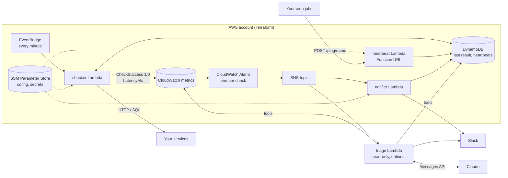

# Watchkeeper

Small, generic monitoring for side projects and small teams, built on AWS
serverless and managed entirely with Terraform. It answers one question:
**"if something stops working, will I find out before my users do?"**

- **Uptime** - is the endpoint up, correct and fast enough?
- **Heartbeats** - did the scheduled job actually run? (catches jobs that never started, not just jobs that crashed)
- **Data freshness** - is the data still updating, or did a pipeline silently stall?
- **SQL checks** - any read-only query that returns a number (e.g. "jobs stuck in `running`")

Failures go to Slack (and optionally email), with the reason. Recoveries are announced too.
It works for services hosted anywhere (AWS, Vercel, Supabase, a VPS) because checks only need an HTTP endpoint or a database connection.

On top of that sits a **read-only AI triage agent** (phase 3): when a check starts failing,
Claude investigates with read-only tools (check history, logs, heartbeats, recent changes)
and posts a structured report with evidence, ranked hypotheses and a proposed next step.
It cannot execute anything; proposals are validated against a human-defined allowlist.
You can run it on your laptop against recorded incident scenarios, and grade it (phase 4).

## Architecture



## Design decisions

| Decision | Why |
|---|---|
| The checker only reports a metric; **alarms decide** when to alert | Alerting rules stay declarative in Terraform. `failure_threshold` (consecutive failures) filters one-off blips. |
| `treat_missing_data = breaching` | If the checker itself dies, every alarm fires. The monitor is monitored. |
| Heartbeats are "dead man's switches" | A job that never starts produces no error to catch. Absence of a ping is the signal. New heartbeat checks get one interval of grace before they can fail. |
| Least-privilege IAM per function | e.g. the checker can `PutMetricData` only in its own namespace and read only the DSN parameters named in `checks.yaml`. |
| SQL checks run in a `READ ONLY` transaction with `statement_timeout` | Defense in depth on top of a read-only DB user. |
| Secrets live in SSM SecureString, created by you | The Slack webhook and DB passwords never appear in Terraform code or state. |
| Initial `INSUFFICIENT_DATA -> OK` transitions are not announced | A fresh deploy should not spam "recovered" messages. |
| Plan tests with mocked providers | `terraform test` checks alarm wiring and config validation in CI with no AWS credentials. |
| Budget alert + 14-day log retention | Cost guardrails are part of the design, not an afterthought. |

## Deployment: GitHub Actions + OIDC

Pushing to `main` runs tests, `terraform plan` and `apply` ([deploy.yml](.github/workflows/deploy.yml)).
No AWS keys exist anywhere: the workflow assumes a role through GitHub OIDC, and the role trusts only
this repository's `aws` / `aws-ops` environments (the `aws` environment can require a human approval per deploy).
A one-time CloudFormation stack ([bootstrap/github-oidc.yaml](bootstrap/github-oidc.yaml)) creates the
OIDC provider, the deploy role, the S3 state bucket and a **permissions boundary** that every role Terraform
creates must carry, so even a bad Terraform change cannot grant a Lambda more than the boundary allows.
Drills (break the demo app, pause the cron, send a test alert) run from [ops.yml](.github/workflows/ops.yml),
leaving an audit trail. Guide (Japanese): [docs/deploy-ja.md](docs/deploy-ja.md)

## Quick start (local)

Full step-by-step guide (Japanese): [docs/setup-ja.md](docs/setup-ja.md)

```bash
make setup                      # Python venv + test deps
make test                       # unit tests + terraform plan tests (no AWS needed)

# one-time: store your Slack incoming-webhook URL
aws ssm put-parameter --type SecureString \
  --name /watchkeeper/slack_webhook_url --value 'https://hooks.slack.com/services/...'

cp terraform/terraform.tfvars.example terraform/terraform.tfvars
make deploy                     # validate config, build package, terraform apply
```

Then break the practice app and watch the alerts arrive:

```bash
make fault MODE=error           # /health returns 500   -> demo-app-health fails
make fault MODE=stale           # data stops updating   -> demo-data-freshness fails
make pause-cron                 # job stops running     -> demo-cron goes overdue
make fault MODE=cron_fail       # job reports a failure -> demo-cron fails
make fault MODE=none            # recover everything
make resume-cron
```

## AI triage on your laptop (no AWS)

```bash
make tools SCENARIO=bad-deploy          # free: see what the agent's tools return
export ANTHROPIC_API_KEY=sk-ant-...
make simulate SCENARIO=red-herring-deploy
make eval MODELS="claude-haiku-5-5 claude-sonnet-5-5" REPEAT=3
```

Four recorded incidents ship in `scenarios/`, two of them designed to mislead
(a recent but unrelated deploy; a job where re-running would make things worse).
`make eval` reports accuracy (root cause, proposal tier, action), tokens, cost and latency per model.
Guide (Japanese): [docs/triage-ja.md](docs/triage-ja.md)

Agent guardrails:

- Read-only IAM; tools are our code, never model-generated commands
- Secrets and personal data are redacted before anything is sent to the model
- Hard step limit; the final turn forces a structured `submit_report`
- Proposed actions are validated against live allowed values (e.g. a rollback target must be a known good deploy); anything else is downgraded to escalation
- One investigation per check per cooldown window, so alarm storms cannot run up a bill
- Tool outputs are compressed (runs of identical results/log lines) to keep token usage low

## Defining checks

Edit [`checks.yaml`](checks.yaml) (it has commented examples of every type), then `make validate && make deploy`.

```yaml
checks:
  - name: my-site
    type: http
    url: https://example.com/
    max_latency_ms: 2000

  - name: nightly-backup
    type: heartbeat
    interval_seconds: 86400
    grace_seconds: 1800
    failure_threshold: 1
```

Report from a job:

```bash
TOKEN=$(make -s token); URL=$(cd terraform && terraform output -raw heartbeat_url)
curl -fsS -X POST -H "Authorization: Bearer $TOKEN" "${URL}ping/nightly-backup"
curl -fsS -X POST -H "Authorization: Bearer $TOKEN" -d "disk full" "${URL}ping/nightly-backup/fail"
```

Try checks from your laptop before deploying: `make local`.

## Cost

With the demo enabled (3 checks), usage stays within AWS's always-free allowances for Lambda,
CloudWatch metrics/alarms and dashboards, so the expected cost is about **$0/month**.
Each additional check adds roughly $0.70/month once you pass 10 alarms / 10 custom metrics
(2 metrics + 1 alarm per check). Verify against current AWS pricing; set `alert_email`
to get a budget alert.

## Project layout

```
checks.yaml              your checks
src/watchkeeper/            check engine (pure logic + AWS adapters)
src/handlers/            Lambda entry points: checker, heartbeat, notifier, triage, demo_app, demo_cron
terraform/               infrastructure; modules/lambda_function is the reusable unit
terraform/tests/         plan tests with mocked providers
tests/                   pytest unit tests (fakes, no network)
src/watchkeeper/triage/     AI triage: agent loop, tools, redaction, action allowlist, scenarios
scenarios/               recorded incidents used by `make simulate` and `make eval`
scripts/                 validate_config.py, run_local.py, simulate.py, evaluate.py
bootstrap/               one-time CloudFormation: OIDC provider, deploy role, boundary, state bucket
.github/workflows/       ci (PRs), deploy (push to main), ops (drills)
```

## Roadmap

Design for phases 3-6: [docs/design-ai-triage.md](docs/design-ai-triage.md)

- [x] Phase 1-2: checks, heartbeats, alarms, Slack, dashboard, practice target
- [x] Deploy from GitHub Actions with OIDC (no long-lived AWS keys), permissions boundary, S3 state
- [x] Phase 3: read-only AI triage agent (runs locally on scenarios; Lambda + IAM ready, off by default)
- [x] Phase 4: evaluation harness - accuracy, cost and latency per model
- [ ] Vercel/GitHub deploy history as a change source (enables rollback proposals in AWS)
- [ ] Phase 5: monitor real services (Vercel + Supabase)
- [ ] Phase 6: human-approved remediation - allowlisted one-click actions, fixes via pull request, escalation with a learning loop
