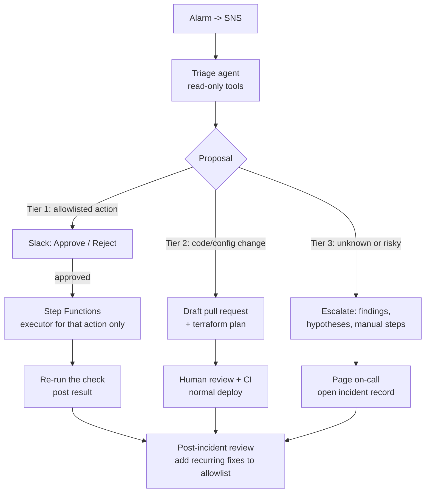

# Design: AI-assisted triage and human-approved remediation

Status: phases 1-4 are implemented (phase 3 runs locally on recorded scenarios; its Lambda is off by default). Phases 5-6 are planned.

> 日本語サマリー: アラート発生時にAIエージェントが読み取り専用で調査し、原因と対処を提案する。
> 対処は「許可リストの操作」「PRによる修正」「人間への引き継ぎ」の3段階で、どれも人間の承認なしには
> 本番を変更しない。AIには実行権限を一切持たせず、実行は操作ごとに最小権限を持つ別のLambdaが行う。
> 人間が対応した障害は振り返りを行い、繰り返すものは許可リストに追加して仕組みを育てる。

## Goals

1. Cut the time from "alarm fired" to "a human understands what is wrong" (first-response time / MTTR).
2. Let a human fix common incidents with one click, safely.
3. Never let the AI change production on its own.

Non-goals: fully autonomous remediation; replacing on-call engineers.

## Core principle

**The AI proposes; a human approves; a narrowly-scoped executor acts.**
The agent has read-only permissions. It cannot execute anything. It can only return a
structured proposal that code validates and a human approves.

## Flow

## Phase 3: read-only triage agent

- Subscribes to the existing SNS alerts topic (no change to phases 1-2).
- Runs in Lambda; calls the Claude API with tool use. Tools are implemented in our code, never by the model
  (`src/watchkeeper/triage/tools.py`), against a pluggable backend (AWS or a recorded scenario):
  - `list_checks`, `get_check_history` - DynamoDB, CloudWatch metrics
  - `search_logs(source, contains, minutes)` - CloudWatch Logs, allowlisted log groups only
  - `get_heartbeat(check)` - DynamoDB
  - `recent_changes(minutes)` - CloudTrail write events (Vercel / GitHub deploy history in phase 5)
- IAM role is read-only. Tool outputs are size-capped; secrets and personal data are masked before being sent to the model.
- Output: summary, evidence (with links), ranked hypotheses with explicit confidence, and a proposal (below).
- Limits: max tool calls and wall time per investigation; one investigation per alarm transition.

## Phase 4: measure the agent

Track per investigation: tokens and cost, latency, tool calls, failure rate.
Keep a set of past incidents with known root causes and replay them as a regression test for diagnosis accuracy.
Route simple classification to a small model and deep investigation to a larger one; compare cost and accuracy.

## Phase 6: remediation tiers

### Tier 1 - allowlisted actions (one-click)

Actions are defined by humans in a registry, each with a parameter schema and its own executor:

| Action | Parameters (validated) | Why it is safe |
|---|---|---|
| `rerun_job` | job name must be a configured heartbeat check | Repeats an existing operation |
| `rollback_deploy` | deployment id must be one of the last N successful deploys | Returns to a known-good state |
| `disable_feature_flag` | flag must be in an allowlist | Stops one feature without a code change |
| `reingest_records` | ids must come from the failing check's own result | Idempotent re-fetch |

The model selects an action id and parameters. Code rejects anything outside the schema.
Irreversible operations (deletes, database writes, security changes) are never in the registry.

**Approval** (requires a Slack App with interactivity, not just an incoming webhook):

- Slack request signatures are verified; the approver must be in an allowed group.
- Approval links expire (e.g. 15 minutes) so stale proposals cannot run.
- AWS Step Functions holds the execution with a task token while waiting (no cost while idle).
- Rate limit: the same action cannot run repeatedly in a short window.
- After execution, the check is re-run and the outcome posted to the thread.
- Audit log: who approved what, when, with which parameters, and the result.

### Tier 2 - change via pull request

When the fix is a code or configuration change, the agent opens a draft PR (with a `terraform plan`
for infrastructure). Review, CI and the normal deploy path are the approval mechanism, and Git history is the audit trail.

### Tier 3 - escalate to a human

When no action fits, confidence is low, or the fix is risky, the agent does not act. It hands over:

- what is known (scope, start time, evidence),
- ranked hypotheses, stating uncertainty plainly,
- suggested commands as text only, each labelled `read-only`, `changes state` or `irreversible`,
- any Tier 1 mitigation that limits impact while root cause is unknown (e.g. rollback),

then pages on-call and opens an incident record.

### What the agent must never do

- Try an action that is not in the registry by other means.
- Request or obtain broader permissions.
- Loop on trial-and-error; investigations have hard limits on steps and time.

## Learning loop

Every Tier 3 incident gets a short post-incident review. If the same fix is needed again,
it becomes a new Tier 1 action with a schema, an executor and tests. The set of things the
system can handle grows deliberately, by human decision.
